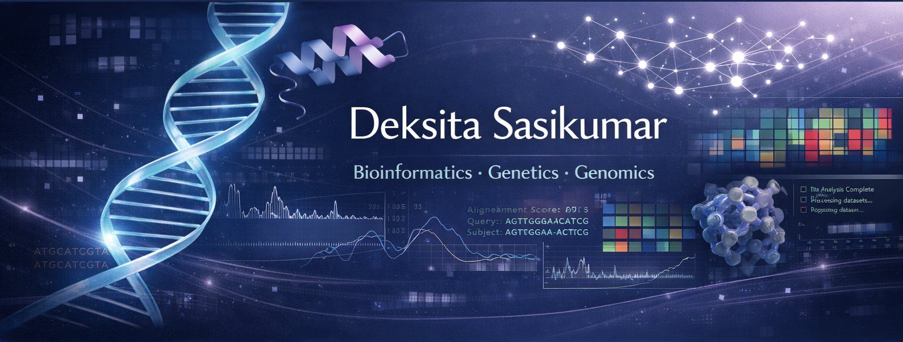

# DEKSITA SASIKUMAR

### B.Tech Biotechnology • Aspiring Bioinformatician • Future Computational Biology Researcher

Passionate about using computation to understand biological systems and to analyze genomic data

---

## ABOUT ME 

- B.Tech Biotechnology @ **SRM Institute of Science and Technology, Ramapuram**
- Interested in Bioinformatics, Genomics and Computational Biology
- Learning Python, R, Linux, SQL, Git & GitHub
- Exploring NGS, Variant Calling, Sequence Analysis and Biological Data Science
- Currently building projects every semester to strengthen my research portfolio

---

## CURRENT FOCUS

- Bioinformatics Project Development
- Python for Biological Data Analysis
- Linux & Bash Scripting
- R Programming
- Biopython
- Data Structures & Algorithms
- Scientific Writing
- Research Portfolio Development

---

## TECHNICAL SKILLS

### Programing

### Bioinformatics

- Sequence Analysis
- FASTA
- BLAST
- Multiple Sequence Alignment

### Tools

---

## FEATURED PROJECTS

### Comparative BRCA1 Evolution Analysis

Cross-species sequence comparison of the BRCA1 gene to study evolutionary conservation.

Skills Used

- Bioinformatics
- NCBI
- Multiple Sequence Alignment
- Sequence Analysis
- Scientific Reporting

---

### Upcoming Projects

- Protein Structure Analysis
- RNA-Seq Analysis
- Variant Calling Pipeline
- Gene Expression Analysis
- Machine Learning for Genomics

---

## CURRENTLY LEARNING

- Advanced Python
- Linux Shell
- R for Bioinformatics
- Biopython
- NGS Data Analysis
- Statistical Genomics
- Machine Learning

---

## ACADEMIC GOALS

- Maintain CGPA above 9.2
- Build research-focused GitHub portfolio
- Publish technical articles
- Complete competitive bioinformatics internships
- Prepare for IELTS

---

## GITHUB STATISTICS

---

## CONNECT WITH ME

